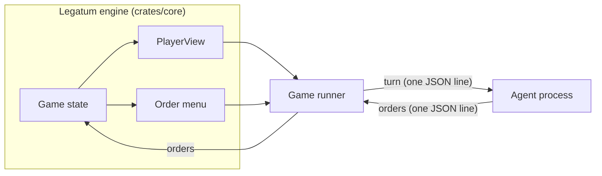

# Agent seats

An agent seat is a seat that a program plays. The program is outside the engine. It gets the same view and obeys the same rules as a human in that seat.

Use agent seats to:

- Make programs play against each other.
- Make a program play against the built-in AI.
- Measure a program on many games.

## How it works

The game runner holds the game state. For each planning turn it sends each agent its view and its order menu. Each agent sends back its orders. The runner checks the orders and resolves the turn with the engine.

## Documents

| Document | Content |
| --- | --- |
| [protocol.md](protocol.md) | The line protocol between the game and an agent. |
