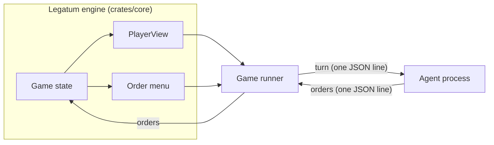

# Agent seats

An agent seat is a seat that a program plays. The program is outside the engine. It gets the same view and obeys the same rules as a human in that seat.

Use agent seats to:

- Make programs play against each other.
- Make a program play against the built-in AI.
- Measure a program on many games.

## How it works



The game runner holds the game state. For each planning turn it sends each agent its view and its order menu. Each agent sends back its orders. The runner checks the orders and resolves the turn with the engine.

## Play a match

Build the tool:

```sh
cargo build --release -p legatum-agent
```

Play your agent in seat 1 against the built-in AI in seat 0:

```sh
target/release/legatum-agent match --agent 1="python3 my_agent.py" --turn-limit 100 --out runs/first
```

Play two agents against each other:

```sh
target/release/legatum-agent match --agent 0="python3 a.py" --agent 1="python3 b.py" --out runs/duel
```

The command splits the agent command on spaces. It does not read quotes. Use `--help` to see all options, for example `--players`, `--map-size`, `--factions`, `--difficulty` and `--turn-ms`.

With `--out DIR`, the tool writes three files:

| File | Content |
| --- | --- |
| `report.json` | The result, the VP of each seat after each turn, and how each agent behaved (answers, late answers, errors, refused orders, the last lines of standard error). |
| `game.legatum` | A save of the last turn. Open it in the game with **Load game** to look at the map. |
| `tape.json` | The orders of each turn. The engine replays it to the same state hashes. |

## Documents

| Document | Content |
| --- | --- |
| [protocol.md](protocol.md) | The line protocol between the game and an agent. |
