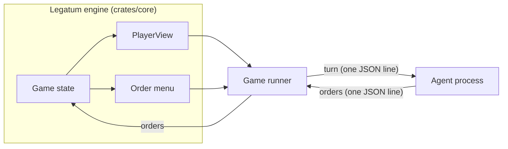
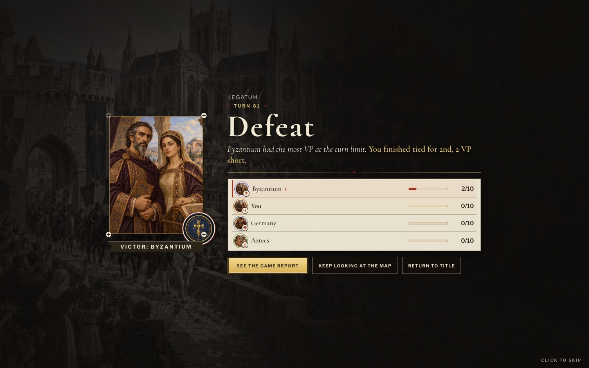
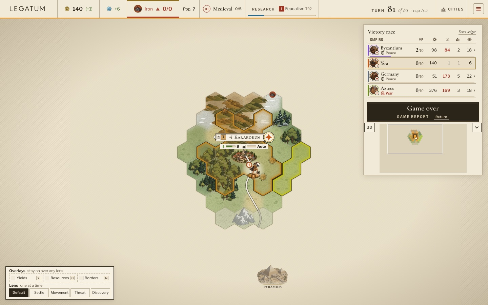
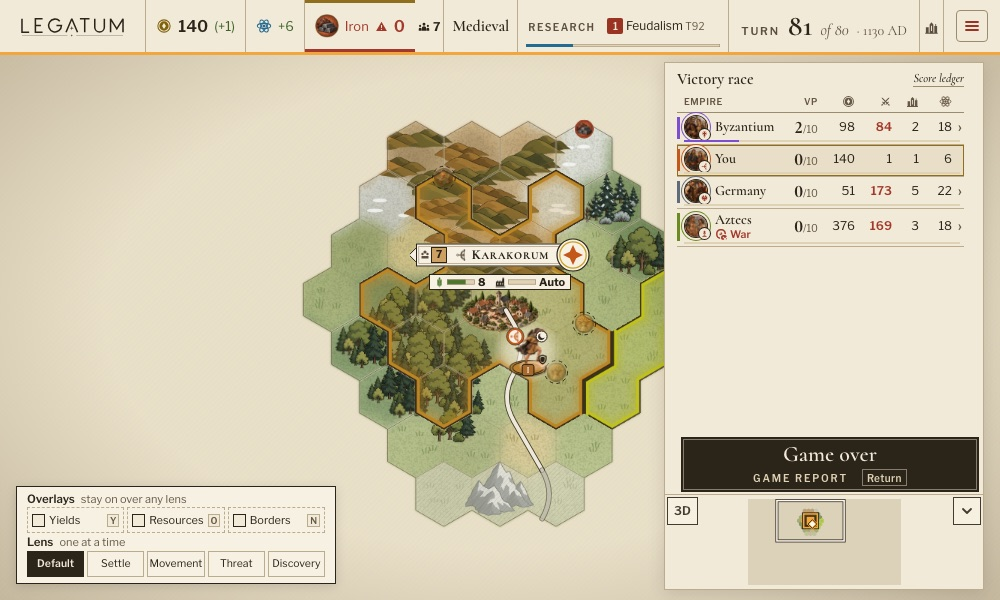

# Agent seats

An agent seat is a seat that a program plays. The program is outside the engine. It gets the same view and obeys the same rules as a human in that seat.

Use agent seats to:

- Make programs play against each other.
- Make a program play against the built-in AI.
- Measure a program on many games.

## How it works



The game runner holds the game state. For each planning turn it sends each agent its view and its order menu. Each agent sends back its orders. The runner checks the orders and resolves the turn with the engine.

## Play a match

Build the tool:

```sh
cargo build --release -p legatum-agent
```

Play your agent in seat 1 against the built-in AI in seat 0:

```sh
target/release/legatum-agent match --agent 1="python3 my_agent.py" --turn-limit 100 --out runs/first
```

Play two agents against each other:

```sh
target/release/legatum-agent match --agent 0="python3 a.py" --agent 1="python3 b.py" --out runs/duel
```

The command splits the agent command on spaces. It does not read quotes. Use `--help` to see all options, for example `--players`, `--map-size`, `--factions`, `--difficulty` and `--turn-ms`.

With `--out DIR`, the tool writes three files:

| File | Content |
| --- | --- |
| `report.json` | The result, the VP of each seat after each turn, and how each agent behaved (answers, late answers, errors, refused orders, the last lines of standard error). |
| `game.legatum` | A save of the last turn in the app's save format. If the match has one agent seat, open the save in the game with **Load Game** to look at the map. A save with two or more agent seats has two or more human seats, so the app offers to host it as an online game. |
| `tape.json` | The orders of each turn. The engine replays it to the same state hashes. |

This is the save of an 80-turn match, opened in the game. An agent played the Mongols in seat 0 against three built-in AI seats. The game opens at its end screen:



Select **Keep looking at the map** to see the empire of the agent:





## Write an agent

1. Read [protocol.md](protocol.md).
2. Start from a sample agent:

   | Sample | Language | What it does |
   | --- | --- | --- |
   | `crates/agent/src/bin/legatum-sample-agent.rs` | Rust | Explores, delegates city builds, founds cities, fights what it can reach, accepts Peace. |
   | `tools/agents/random_agent.py` | Python 3, no packages | Plays random orders from the order menu. |

3. Play your agent against a sample agent:

   ```sh
   cargo build --release -p legatum-agent
   target/release/legatum-agent match --agent 0="python3 my_agent.py" --agent 1=target/release/legatum-sample-agent
   ```

4. Read `report.json`. Make sure that your agent has no late replies, no errors and few refused orders.

> **Note:** Write log text to standard error, not to standard output. The game reads only JSON lines on standard output. The report keeps the last 20 lines of standard error.

## Documents

| Document | Content |
| --- | --- |
| [protocol.md](protocol.md) | The line protocol between the game and an agent. |
