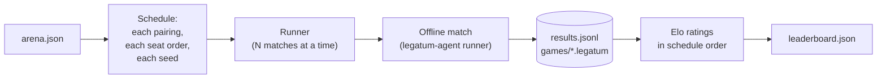

# The arena

The arena plays many matches between entrants and rates the entrants. An entrant is an agent or the built-in AI at one level. Use the arena to compare agents with each other and with the built-in AI.

## How it works



1. The schedule makes one fixture for each group of entrants, in each seat order, for each seed. In two-player matches, each pair plays two times for each seed, one time in each seat.
2. The runner plays the fixtures with the offline match runner. It keeps each result as one line in `results.jsonl` and a save in `games/`, in the app's save format.
3. The ratings use Elo. The runner applies the results in schedule order. Thus the ratings do not change when matches finish in a different order.

## Write an arena file

```json
{
  "entrants": [
    {"name": "My agent", "command": ["python3", "my_agent.py"], "dir": "agents"},
    {"name": "Hard AI", "builtin": "Hard"}
  ],
  "schedule": {"players": 2, "map": "small", "seeds": 4, "first_seed": 1, "turn_limit": 150, "barbarians": true},
  "limits": {"hello_ms": 10000, "turn_ms": 30000}
}
```

| Field | Meaning |
| --- | --- |
| `name` | A unique name. The arena keeps results by name. |
| `command` | The program and its arguments. The arena does not use a shell. |
| `dir` | The folder in which the agent runs, relative to the arena file. If you do not give it, the agent runs in the folder of the arena file. |
| `builtin` | `Easy`, `Normal` or `Hard`: the built-in AI. Give `command` or `builtin`, not both. |
| `schedule` | Players in each match, map size, number of seeds, first seed, turn limit and barbarians. |
| `limits` | The time in milliseconds for each agent reply. |

`tools/agents/arena.example.json` is an arena of the two sample agents and two levels of the built-in AI.

## Run the arena

```sh
cargo build --release -p legatum-agent -p legatum-arena
target/release/legatum-arena run --config tools/agents/arena.example.json --out runs/arena --jobs 4
```

The command plays each fixture that has no result, then shows the standings. If you stop the command, start it again with the same options. It continues with the fixtures that have no result.

To see the standings without a new match, use `legatum-arena table` with the same `--config` and `--out`.

## Places and ratings

- The winning team gets first place. The other seats get places by their victory points.
- Seats with equal victory points and no win get the same place.
- Each pair of seats in a match counts as one game for Elo. One match changes a rating by 32 points or less.
