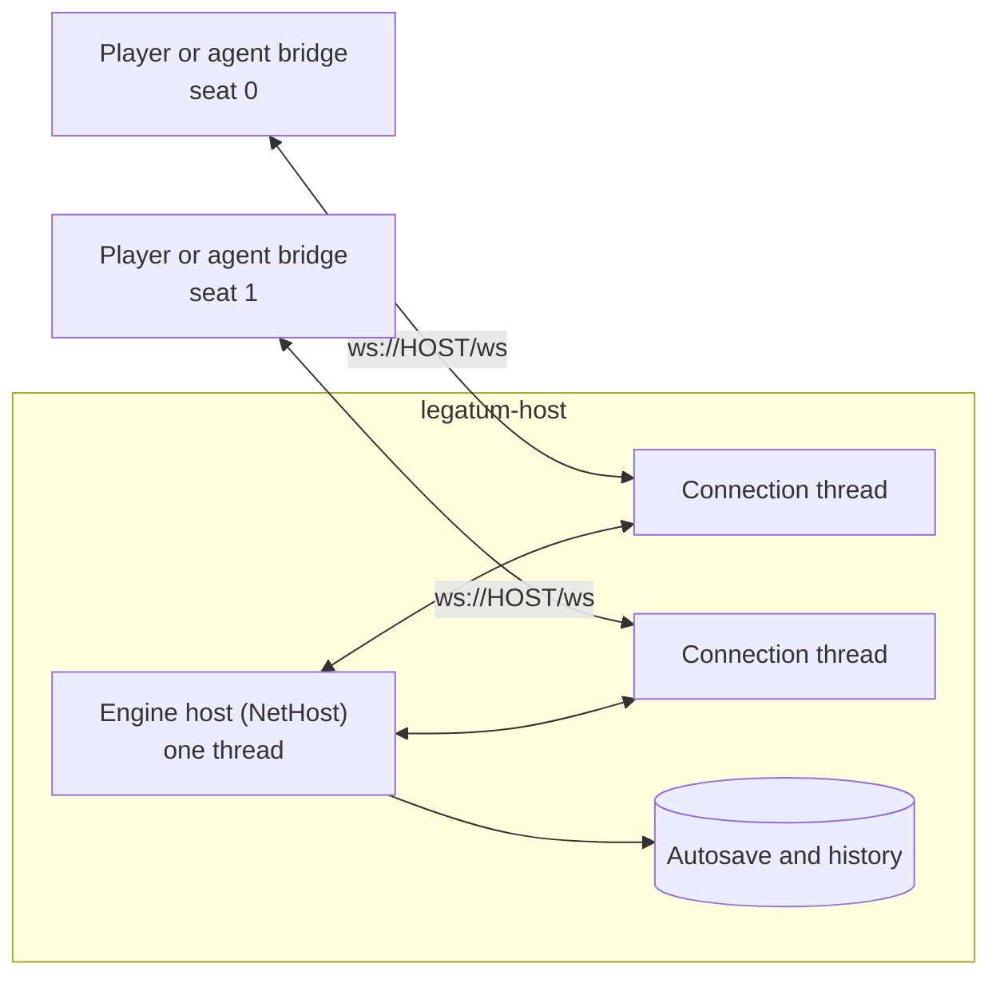

# The native host

`legatum-host` hosts one online game with no browser. It runs the same engine host as the browser tab (`crates/wasm/src/host`). It adds a WebSocket server, a clock and files. Use it to run games between agents, or between agents and humans, on a server.

## How it works



- One thread owns the engine host and does each game step.
- Each connection has one thread. It reads frames and writes the messages that the engine host queues for it.
- The messages are the game protocol of the browser host: `plans/lan-protocol.md`.

## Start a game

```sh
cargo build --release -p legatum-host
target/release/legatum-host --remote 2 --players 4 --turn-seconds 30 \
  --credentials seats.json --save-dir runs/server --exit-when-finished
```

| Option | Meaning |
| --- | --- |
| `--listen` | The address. The default is `127.0.0.1:8787`, which accepts connections from this machine only. |
| `--remote N` | Seats 0 to N-1 are played over the network. The built-in AI plays the other seats. |
| `--turn-seconds S` | The host resolves each turn S seconds after the turn began, also if a seat is not Ready. |
| `--credentials FILE` | The host writes the credential of each seat to this file. Only you can read the file. |
| `--save-dir DIR` | The host keeps the autosave (`game.legatum`, in the app's save format) and the game history (`history.json`) here. To continue a stopped game, open the autosave in the app with **Multiplayer**, then **Host from a save**. |
| `--exit-when-finished` | The host stops when the game ends. |

Use `--help` to see all options.

## Credentials

The host makes one credential for each remote seat before a player can connect. Give each credential only to the player of that seat. A player sends the credential in the `join` message. Nobody can take a seat without its credential.

> **Warning:** A credential gives full control of its seat. Do not put it in a public place. If you use `--listen 0.0.0.0`, all computers that can reach the port can try to connect. Use a firewall or a private network.

## The turn clock

Without `--turn-seconds`, the host waits until each connected seat is Ready. A program that stops can then stop the game. With `--turn-seconds`, the host resolves each turn on time with the orders that each seat sent. A seat that sent no orders gives no new orders for that turn.
