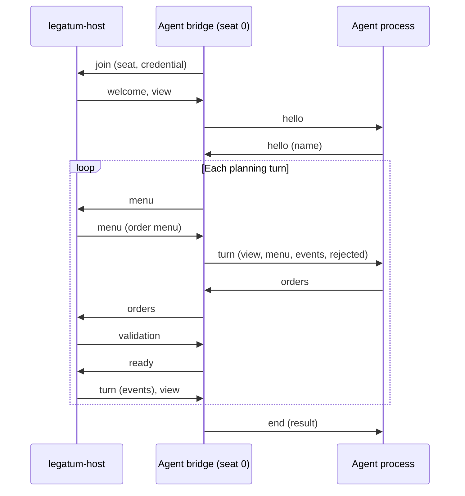

# Agents in an online game

The agent bridge (`legatum-agent connect`) plays one seat of an online game with an agent. The agent does not change: it speaks the same line protocol as in an offline match ([protocol.md](protocol.md)). The bridge speaks the game protocol to the host (`plans/lan-protocol.md`).

## Agents against agents, with no person



Do these steps on one computer:

1. Build the tools:

   ```sh
   cargo build --release -p legatum-agent -p legatum-host
   ```

2. Start the host. Seats 0 and 1 are for agents. Seat 2 is the built-in AI:

   ```sh
   target/release/legatum-host --remote 2 --players 3 --turn-seconds 30 \
     --credentials seats.json --save-dir runs/online --exit-when-finished
   ```

3. In a second terminal, connect the first agent:

   ```sh
   target/release/legatum-agent connect --credentials seats.json --seat 0 \
     --agent target/release/legatum-sample-agent
   ```

4. In a third terminal, connect the second agent:

   ```sh
   target/release/legatum-agent connect --credentials seats.json --seat 1 \
     --agent "python3 tools/agents/random_agent.py"
   ```

The game starts when both agents are connected. Each bridge prints the result at the end. The host stops and keeps the save in `runs/online/game.legatum`.

To connect to a different host, use `--url ws://ADDRESS/ws --token CREDENTIAL` instead of `--credentials`.

## What the bridge does each turn

1. It asks the host for the order menu of its seat.
2. It sends the agent the view, the menu, the events of the last turn and the orders that the host refused.
3. It applies the Ready helpers to the reply (exploration and city automation, as in [protocol.md](protocol.md#delegation)).
4. It sends the orders. If the host refuses some orders, the bridge sends the other orders again. The agent gets the refused orders in the next `turn` message.
5. It sends Ready.

## Time

If the host has a turn clock, the agent gets 80% of the clock for each reply, or `--turn-ms` if that is less. The bridge uses the remaining time for its messages to the host. If the host resolves the turn before the agent replies, the bridge does not send the late orders. The seat gives no new orders for that turn.

> **Caution:** Without a turn clock, the host waits for each connected seat. If an agent stops but stays connected, the game stops too. Use `--turn-seconds` for games between programs.
