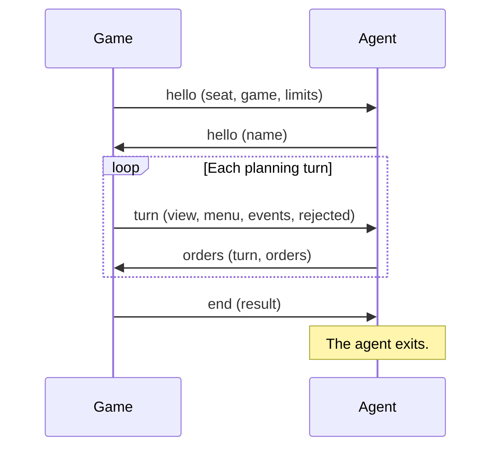

# Agent protocol, version 1

This document tells you how to write a program that plays one seat of a Legatum game. We call this program an **agent**. The types are in `crates/agent/src/protocol.rs`.

## Rules for agents

- An agent plays under the same rules as a human. It gets no bonus.
- An agent gets only its own view. It does not get hidden information.
- An agent is a separate process. The game starts it and stops it.

## Transport

The game starts the agent as a child process. The game and the agent send messages through the standard streams:

| Stream | Direction | Content |
| --- | --- | --- |
| Standard input | Game to agent | One JSON message on each line |
| Standard output | Agent to game | One JSON message on each line |
| Standard error | Agent to game | Free text. The game keeps the last lines for the log. |

Each message is one line of compact JSON. Each message has a `type` field. Do not write other text to standard output.

## Message sequence



1. The game sends `hello`. The agent sends `hello` in return.
2. For each planning turn, the game sends `turn`. The agent sends `orders` for the same turn.
3. At the end, the game sends `end`. The agent must exit. It does not send a reply.

If your empire is eliminated, the game sends no more `turn` messages. You get `end` when the match ends.

## Messages from the game

### `hello`

| Field | Type | Meaning |
| --- | --- | --- |
| `protocol` | number | The protocol version. This document is version 1. |
| `rules_version` | number | The rules version of the engine. |
| `seat` | object | `player`, `team` and `faction` of your seat. |
| `game` | object | `width`, `height`, `turn_limit` (or `null`) and `players`. Each player has `player`, `team`, `faction` and `kind` (`agent` or `ai`). |
| `limits` | object | `hello_ms` and `turn_ms`: the time in milliseconds that the game waits for each reply. |

### `turn`

| Field | Type | Meaning |
| --- | --- | --- |
| `turn` | number | The planning turn. Send it back in `orders`. |
| `view` | object | Your `PlayerView`. It is the same view that a human in your seat sees. |
| `menu` | object | The order menu: orders that are valid alone this turn. See [The order menu](#the-order-menu). |
| `events` | array | The events that your team saw in the turn before. Each event has a `type` field. |
| `rejected` | array | The orders from your last reply that the game refused. Each item has `index` and `message`. |

### `end`

| Field | Type | Meaning |
| --- | --- | --- |
| `result.turn` | number | The last turn. |
| `result.winner` | number or `null` | The team that won, or `null` if no team won. |
| `result.vp` | array | `[player, vp]` for each seat, in seat order. |
| `result.reason` | string | `victory`, `turn_limit` or `stopped`. |

## Messages from the agent

### `hello`

```json
{"type":"hello","name":"Greedy","version":"0.3"}
```

`name` is the display name in reports. The game removes control characters and keeps 80 characters or fewer. `version` is optional.

### `orders`

```json
{"type":"orders","turn":4,"orders":[{"type":"MoveUnit","unit":7,"to":{"q":3,"r":2}}]}
```

Send the orders for the turn in the `turn` message. Each order has the same JSON shape as an `Order` in `crates/core/src/orders.rs`. To give no new orders, send an empty list. Standing orders, such as a destination or Sleep, continue from turn to turn.

The game checks the orders. It removes the orders that are not valid and plays the other orders. The next `turn` message lists the removed orders in `rejected`.

## The order menu

The menu lists single orders that are valid for your seat this turn. The engine makes the menu from your view, and it checks each order alone. Thus the menu tells you nothing that your view does not tell you.

| Field | Content |
| --- | --- |
| `units` | One item for each of your units: `unit`, `kind`, `pos` and `orders`. |
| `cities` | One item for each of your cities: `city`, `name` and `orders`. |
| `empire` | Research and diplomacy orders. |

Use the menu to select orders. You can also make orders that are not in the menu, for example `MoveUnit` to a tile that is far away.

> **Caution:** Each menu order is valid alone. Two orders that use the same Gold, the same strategic supply or the same city purchase can be refused together. Give one order for each unit and one for each city.

The rules reference lists what the menu contains: `.claude/skills/legatum-rules/references/turn-and-orders.md`, "Order menu".

## Time and errors

- Reply to `hello` in `limits.hello_ms` milliseconds. If the reply to `hello` is late or not valid, the game stops the agent. The seat then gives no orders for the rest of the game.
- Reply to each `turn` in `limits.turn_ms` milliseconds.
- If a reply is late, the seat gives no new orders for that turn. The game does not wait.
- If a reply is not valid JSON, or has the wrong `type` or `turn`, the seat gives no new orders for that turn.
- If the agent exits or closes its standard output, the seat gives no new orders until the end of the game.
- A line must be 1 MiB or less. A reply must have 2,000 orders or fewer.

## Version changes

We increase `protocol` when a change can cause an agent for the old version to read a message incorrectly. New optional fields do not change the version. Ignore fields that you do not know.
